  

  
  

  <b>Full Stack Development</b> &nbsp; • &nbsp; <b>Data Science & Analytics</b>

  Building useful web applications, exploring data, and turning ideas into practical solutions.

---

## About Me

Hi, I'm **Durga Ganesh** — a Computer Science student interested in both software development and data-driven problem solving.

I enjoy building applications from the user interface through backend services, and exploring datasets to find patterns, communicate insights, and experiment with machine learning. I want my work to bring these two areas together wherever it makes sense.

- 💻 **Full Stack Development:** responsive interfaces, backend services, APIs, and database-driven applications.
- 📊 **Data Science & Analytics:** data cleaning, exploratory analysis, visualization, dashboards, and predictive modeling.
- 🌱 **Currently focused on:** improving project quality, strengthening fundamentals, and documenting how my projects work.
- 🎯 **My approach:** build thoughtfully, analyze carefully, and keep learning.

## Two Equal Areas of Focus

<table>
  <tr>
    <td width="50%" valign="top">
      <h3>💻 Full Stack Development</h3>
      
Building and connecting the pieces of a web application.

      <ul>
        <li>Frontend development with React</li>
        <li>Backend APIs with Node.js and Express</li>
        <li>Database integration with MongoDB</li>
        <li>Application workflows and responsive UI</li>
      </ul>
    </td>
    <td width="50%" valign="top">
      <h3>📈 Data Science & Analytics</h3>
      
Turning raw data into analysis, visualizations, and models.

      <ul>
        <li>Data preparation and exploratory analysis</li>
        <li>Python-based analysis and visualization</li>
        <li>Dashboards and business reporting</li>
        <li>Classification models and model evaluation</li>
      </ul>
    </td>
  </tr>
</table>

## Tech Stack

### Full Stack Development

  
  
  
  
  
  
  
  

### Data Science & Analytics

  
  
  
  
  
  
  
  
  

### Programming & Tools

  
  
  
  

## Featured Projects

### 💻 Full Stack & Application Development

<table>
  <tr>
    <td width="50%" valign="top">
      <h3><a href="https://github.com/DurgaGanesh05/beauty-wellness-webApp">Beauty & Wellness Web App</a></h3>
      
A web application for discovering services and professionals, with user authentication, service listings, appointment booking, reviews, and profiles.

      
React · Node.js · Express · MongoDB

    </td>
    <td width="50%" valign="top">
      <h3><a href="https://github.com/DurgaGanesh05/investment-agent">AI Investment Research Agent</a></h3>
      
A research application that orchestrates a multi-stage company analysis workflow and returns a structured investment thesis and recommendation.

      
React · Vite · Express · LangGraph · Groq

      
<a href="https://investment-agent-frontend.onrender.com">Live frontend</a> · <a href="https://investment-agent-3uzp.onrender.com/health">Backend health</a>

    </td>
  </tr>
  <tr>
    <td width="50%" valign="top">
      <h3><a href="https://github.com/DurgaGanesh05/travel-ai-agent">TravelAI</a></h3>
      
A responsive travel-planning experience with destination discovery, a multi-step planner, motion design, and interactive visual elements.

      
React · Vite · Tailwind CSS · Framer Motion · Three.js

      
<a href="https://travel-ai-agent-bay.vercel.app/">Live demo</a>

    </td>
    <td width="50%" valign="top">
      <h3><a href="https://github.com/DurgaGanesh05/Amazon-Clone">Amazon Clone</a></h3>
      
An e-commerce interface project that demonstrates frontend implementation practice.

      
See repository for current implementation details

    </td>
  </tr>
</table>

### 📊 Data Science & Analytics

<table>
  <tr>
    <td width="50%" valign="top">
      <h3><a href="https://github.com/DurgaGanesh05/Super-Store-Sales-Analysis">Superstore Sales Analysis</a></h3>
      
Explores sales, profit, discounts, quantity, and product categories using data cleaning, summary metrics, visualizations, and outlier analysis.

      
Python · Pandas · NumPy · Matplotlib · Seaborn · SciPy

    </td>
    <td width="50%" valign="top">
      <h3><a href="https://github.com/DurgaGanesh05/Loan-Approval-Predictor">Loan Approval Predictor</a></h3>
      
An end-to-end machine-learning project that preprocesses applicant data, compares classification models, and serves predictions through a Flask app.

      
Python · Pandas · scikit-learn · Flask

    </td>
  </tr>
  <tr>
    <td width="50%" valign="top">
      <h3><a href="https://github.com/DurgaGanesh05/Road-Traffic-Accident-Severity-Prediction-using-Machine-Learning">Road Traffic Accident Severity Prediction</a></h3>
      
Uses historical accident records and a Decision Tree classifier to predict accident severity classes.

      
Python · Data preprocessing · Machine learning

    </td>
    <td width="50%" valign="top">
      <h3><a href="https://github.com/DurgaGanesh05/Product-Category-Insights-Dashboard">Sales Insights Dashboard</a></h3>
      
An Excel dashboard project covering data preparation, sales trends, product performance, profitability, and interactive filtering.

      
Excel · Power Query · PivotTables · Charts

    </td>
  </tr>
</table>

## GitHub Overview

  
  

## Contribution Snake

This animation is generated automatically from my GitHub contribution graph by GitHub Actions.

  

## Let's Connect

- GitHub: [@DurgaGanesh05](https://github.com/DurgaGanesh05)
- Browse my work: [Repositories](https://github.com/DurgaGanesh05?tab=repositories)

  

